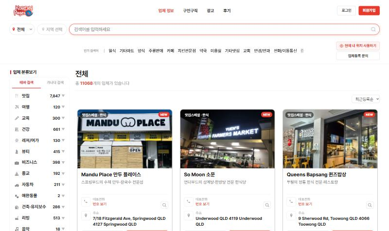
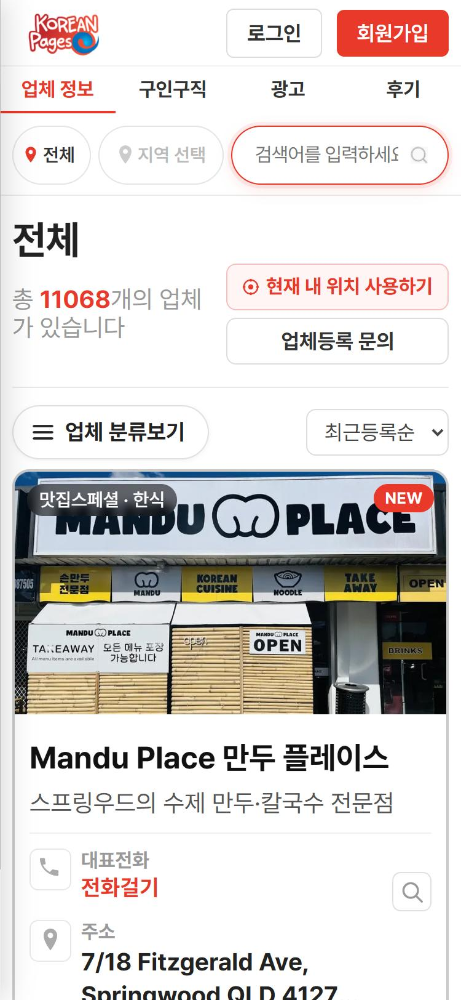
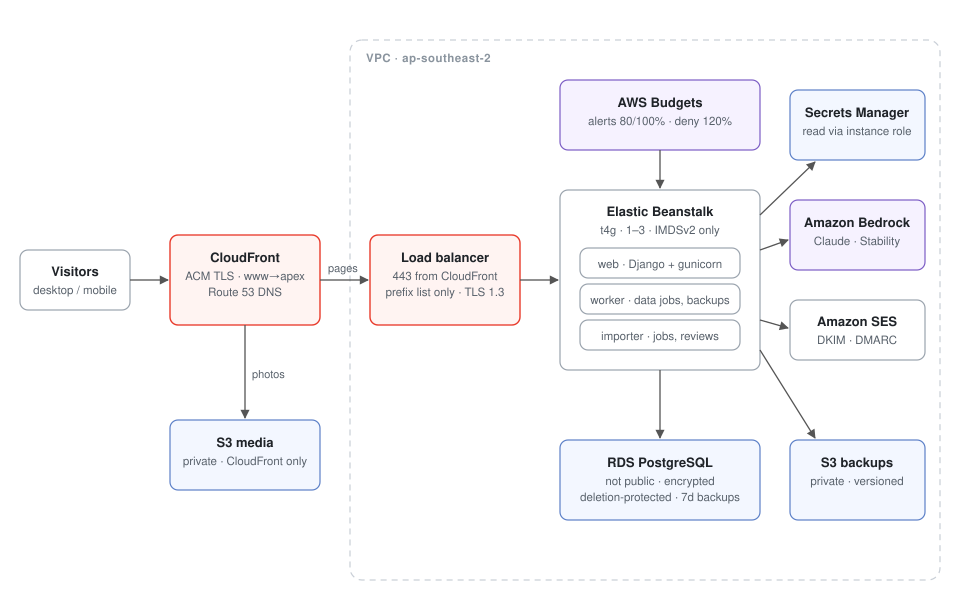

# Korean Pages Platform

[](.github/workflows/security.yml)

Migration of a live business directory (11,000+ Korean-owned businesses across Australia) from a legacy hosted PHP CMS to Django on AWS, rebuilt so that every page looks and behaves exactly as before while the platform underneath was replaced and hardened.

**Live:** https://koreanpages.com.au

| Desktop | Mobile |
|---|---|
|  |  |

---

## Project Objectives

The old site ran on a commercial CMS on shared hosting that was being shut down. A review before migration found:

- member passwords hashed with an MD5-based scheme
- jQuery 1.3.2 (2009) loaded on every page
- diagnostic PHP scripts left in the public web root
- FTP deployment with credentials sent in clear text

Details: [docs/legacy-risk-assessment.md](docs/legacy-risk-assessment.md)

## Results

| | |
|---|---|
| Listings served | 11,068 |
| Production releases | 55+, rolling, no downtime |
| Legacy password hashes migrated | 0 (launched with zero member accounts) |
| Secrets in repository history | 0 (scanned before publishing) |
| Release gate | 61 automated checks before every deploy |
| Vulnerabilities fixed during the security review for this repo | SSRF in an admin link importer; Pillow decoder exposure on uploads ([docs/findings-fixed.md](docs/findings-fixed.md)) |

## Architecture



- **Edge:** CloudFront with ACM certificates. The load balancer only accepts HTTPS from CloudFront's origin-facing prefix list, and its plain-HTTP listener is disabled.
- **Compute:** Elastic Beanstalk on Graviton (t4g), with 3 processes: web (gunicorn), worker (data jobs, backups), importer (job boards, reviews). IMDSv1 is disabled. Platform patches apply weekly through managed updates.
- **Data:** RDS PostgreSQL: not publicly accessible, encrypted, deletion-protected, 7-day backups. Photos live in a private S3 bucket readable only by CloudFront. Backups go to a separate private, versioned bucket.
- **Secrets:** AWS Secrets Manager, read at startup through the instance role. There are no keys on disk or in code.
- **Email:** SES with DKIM and DMARC.
- **AI:** Claude models and Stability image generation on Amazon Bedrock, behind a monthly cost ceiling.

More: [docs/architecture.md](docs/architecture.md)

## Security controls

| Area | Control |
|---|---|
| Network | Origin reachable only through CloudFront; database not publicly accessible; TLS 1.3 policy on the load balancer |
| Secrets | Secrets Manager + instance role; history scan in CI |
| Authentication | PBKDF2 hashing, lockout after 5 failed passwords, email-code sign-up, 3-step reset, one-time admin setup link |
| Requests | Origin/Referer check on legacy XHR endpoints that can't send CSRF tokens; Secure cookies; `X-Frame-Options`, `nosniff`, `Referrer-Policy` |
| Input | Output escaped before any HTML is built; uploads decoded only as JPEG/PNG/GIF/WebP; outbound fetches allow-listed by host on every redirect |
| Integrity | One service layer for all listing changes: every change recorded with its source, and reversible. A restore takes a backup first |
| AI | Changes publish only above a confidence threshold **and** after external verification; schema-constrained output; human review queue; monthly spend ceiling |
| Supply chain | gitleaks, bandit and pip-audit on every push |

- Threat model: [docs/threat-model.md](docs/threat-model.md)
- AI guardrails: [docs/ai-guardrails.md](docs/ai-guardrails.md)
- What's still open: [docs/open-findings.md](docs/open-findings.md)

## Repository contents

```
app/          selected modules from the production code (see "Scope" below)
infra/        Elastic Beanstalk config, nginx, AWS Budgets definitions (IDs replaced)
tools/        release smoke test, bundle builder, secret scan
docs/         architecture, threat model, risk assessment, runbooks, findings
```

## Scope

This repository holds my own code and documentation. The production repository is private. Among other things it contains the original CMS vendor's page templates, which aren't mine to publish. The modules in `app/` are copied from production with account-specific identifiers replaced. They show the design and won't run on their own.

## Stack

Python · Django 6 · PostgreSQL · gunicorn · AWS (Elastic Beanstalk, EC2, ALB, CloudFront, S3, RDS, Secrets Manager, IAM, ACM, Route 53, SES, Bedrock, Budgets) · Claude on Bedrock · Google Places API

## Contact

Jihun Baek: [LinkedIn](https://www.linkedin.com/in/jihun-baek-505544270) · [GitHub](https://github.com/JihunB)
Security issues: see [SECURITY.md](SECURITY.md)
